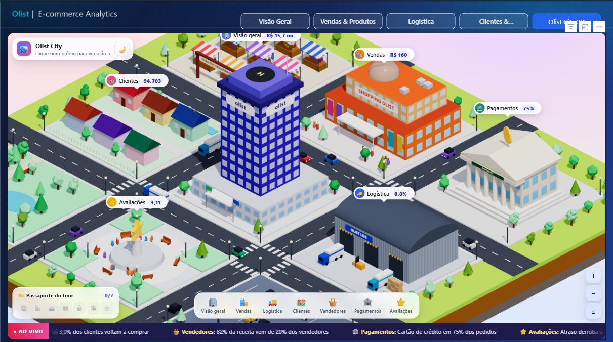
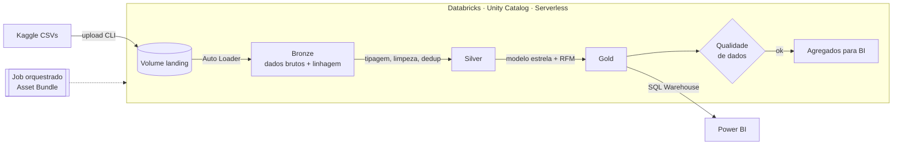
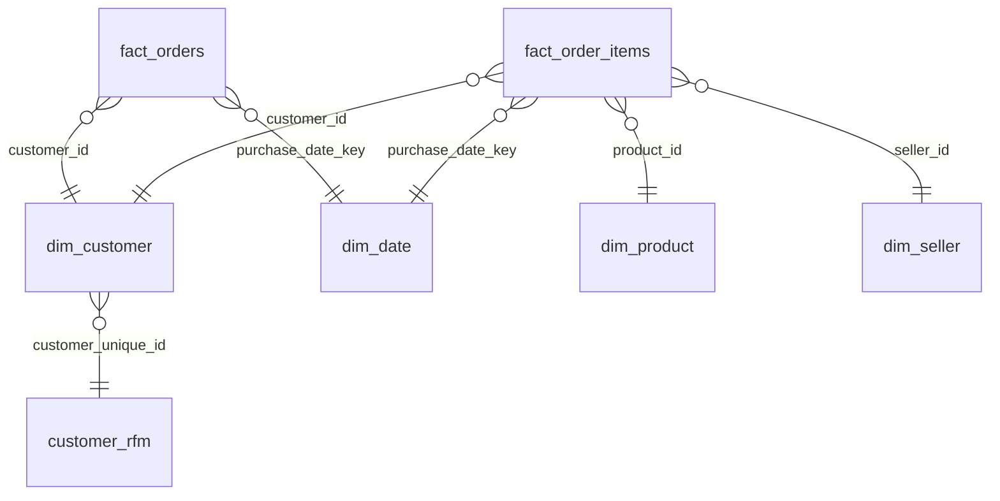

# 🛒 Olist Lakehouse: Databricks + Power BI

Pipeline de dados ponta a ponta sobre o **e-commerce brasileiro Olist** (~100 mil pedidos, 2016–2018):
ingestão incremental no Databricks com arquitetura medalhão, modelo estrela no Unity Catalog,
testes de qualidade automatizados e dashboard no Power BI.



**🌐 [Abrir a Olist City ao vivo](https://jx-dev-c.github.io/olist-lakehouse-databricks-powerbi/olist-city/)**: a versão web da cidade, que roda no navegador sem instalar nada.

*Página **Olist City 3D** do relatório: visual personalizado em three.js. Cada prédio é uma área do negócio, e os números das etiquetas, do painel e do letreiro vêm de medidas DAX.*

## Arquitetura



| Camada | Notebook | O que faz |
|---|---|---|
| Setup | [`00_setup`](notebooks/00_setup.py) | Cria schemas e volumes e valida os arquivos de entrada |
| Bronze | [`01_bronze_ingestion`](notebooks/01_bronze_ingestion.py) | Auto Loader incremental (`availableNow`), schema como string, metadados `_source_file` / `_ingested_at` |
| Silver | [`02_silver_transform`](notebooks/02_silver_transform.py) | `try_cast` seguro, padronização de texto, deduplicação pela versão mais recente, geolocalização por CEP |
| Gold | [`03_gold_star_schema`](notebooks/03_gold_star_schema.py) | 2 fatos + 4 dimensões, calendário em PT-BR, segmentação RFM |
| Qualidade | [`04_data_quality`](notebooks/04_data_quality.py) | 20 verificações (PK, FK, regras de negócio, reconciliação), histórico em `dq_results`; falha bloqueia o job |
| Agregados | [`05_bi_aggregates`](notebooks/05_bi_aggregates.py) | KPIs mensais, atraso × avaliação, desempenho de vendedores |

Todas as transformações usam a **API de DataFrame do PySpark**. `spark.sql` aparece apenas em DDL (`CREATE SCHEMA`/`VOLUME`, `COMMENT ON TABLE`).

## Modelo estrela (Gold)



## Perguntas de negócio

1. Como receita, pedidos e ticket médio evoluíram mês a mês?
2. Quais estados e regiões sofrem mais com atraso na entrega?
3. **Quanto o atraso derruba a nota da avaliação?** (`gold.agg_atraso_vs_avaliacao` e página *Clientes & Avaliações*)
4. Quais categorias e vendedores concentram a receita, e qual é a satisfação deles?
5. Como se distribui a base de clientes nos segmentos RFM, e quanto ela é recorrente?

## Principais insights

Período analisado: jan/2017 a ago/2018. São **97,9 mil pedidos válidos**, **R$ 15,7 milhões** em receita e ticket médio de **R$ 160,19**.

**Definição de receita** (a mesma no dashboard e na Olist City): preço + frete dos itens de pedidos válidos. Pedidos `canceled` e `unavailable` ficam fora.

- 📈 **Crescimento forte, mas em platô.** De jan a ago/18, a receita foi **+140%** maior que no mesmo período de 2017. Desde jan/18, porém, a receita mensal fica entre R$ 0,98 e 1,16 milhão: o recorde continua sendo **nov/17** (Black Friday, R$ 1,17 milhão). Em ago/18, a alta sobre ago/17 caiu para +51%. O crescimento anual está desacelerando.
- ⭐ **O atraso derruba a satisfação.** Pedidos no prazo têm nota média **4,29**; atrasados, **2,27**. A partir de 6 dias de atraso, **78%** das avaliações são negativas (1–2 estrelas), contra 9% nas entregas no prazo.
- 📦 **6,8% das entregas atrasam, mas o prazo prometido é muito folgado.** A entrega real leva em média **12,5 dias** contra **24,3 prometidos**. O atraso se concentra no Nordeste e no RJ. Entre os estados com 500+ pedidos entregues: **MA (17,5%)**, CE (13,8%), BA (12,2%) e RJ (12,2%), de 1,8× a 2,6× a média nacional.
- 🔁 **Retenção é a maior oportunidade.** Só **3,0%** dos 94,7 mil clientes compraram mais de uma vez. O segmento RFM *Em risco (alto valor)* reúne 13,8 mil clientes que já gastaram R$ 4,2 milhões e não voltaram.
- 🏷️ **Categorias pulverizadas, vendedores concentrados.** As 5 maiores categorias (Beleza e Saúde; Relógios e Presentes; Cama, Mesa e Banho; Esporte e Lazer; Informática e Acessórios) somam **39,9%** da receita de produtos. Já entre vendedores, **20% dos 3.029** respondem por **82%** da receita.

Nota da base completa (2016–2018) por faixa de entrega:

| Faixa de entrega | Pedidos | Nota média | % avaliações negativas |
|---|---:|---:|---:|
| 10+ dias adiantado | 61.523 | 4,32 | 8,9% |
| No prazo | 27.920 | 4,22 | 10,1% |
| 1 a 5 dias de atraso | 2.722 | 2,99 | 41,1% |
| 6 a 15 dias de atraso | 2.479 | 1,74 | 78,2% |
| 15+ dias de atraso | 1.180 | 1,73 | 78,3% |

**Qualidade dos dados:** as 17 verificações bloqueantes passaram. Três anomalias da origem ficam registradas como aviso: 1 pedido sem pagamento, 8 pedidos "entregues" sem data de entrega e 279 clientes com CEP sem coordenadas.

## Como reproduzir

**Pré-requisitos:** conta na [Databricks Free Edition](https://www.databricks.com/learn/free-edition), [Databricks CLI](https://docs.databricks.com/dev-tools/cli/install.html) e Power BI Desktop.

```powershell
# 1. Autenticar a CLI no seu workspace
databricks auth login --host https://<seu-workspace>.cloud.databricks.com

# 2. Deploy do job (notebooks + orquestração)
databricks bundle deploy

# 3. Rodar o setup uma vez para criar o volume (vai falhar avisando que faltam arquivos, é esperado)
databricks bundle run olist_pipeline

# 4. Baixar o dataset e enviar os CSVs
#    https://www.kaggle.com/datasets/olistbr/brazilian-ecommerce  -> extrair em .\data
.\scripts\upload_dados.ps1 -Pasta .\data

# 5. Rodar o pipeline completo
databricks bundle run olist_pipeline
```

Alternativa sem CLI: importe a pasta `notebooks/` no workspace, crie o volume pelo Catalog Explorer, faça o upload dos CSVs pela interface e rode os notebooks em ordem.

Depois, siga o guia [`powerbi/README.md`](powerbi/README.md) para conectar o Power BI.

## Dashboard

São cinco páginas, cada uma aberta por uma pergunta de negócio:

| Página | Pergunta |
|---|---|
| Visão Geral | O negócio está crescendo? |
| Vendas & Produtos | O que vende e quem concentra a receita? |
| Logística | Onde e quando atrasamos? |
| Clientes & Avaliações | O que derruba a satisfação? |
| Olist City 3D | A operação inteira numa cidade |

- **KPIs do mês de referência.** Cada KPI mostra a variação contra o mês anterior (m/m) e contra o mesmo mês do ano anterior (a/a). Taxas aparecem em pontos percentuais, e uma variação que arredonda para zero fica neutra (■), nunca "▲ 0,00".
- **Insights dinâmicos.** Os textos são medidas DAX recalculadas a cada filtro. Quando a amostra é pequena (menos de 30 avaliações ou estados com menos de 500 pedidos), o insight avisa em vez de concluir.
- **Gráfico de receita.** Mostra a série do ano anterior junto (só nos meses com amostra suficiente) e marca o pico automaticamente.

### Visuais personalizados (TypeScript)

Todos são visuais próprios: nenhum depende de visual pago, e nenhum tem marca d'água.

| Visual | O que faz |
|---|---|
| [`mapaBrasil3D`](mapaBrasil3D/README.md) | Os 27 estados em 3D com **three.js**: altura pelos pedidos, cor pelo % de atraso, animação em onda, dica de ferramenta e filtro cruzado. Geometria da malha oficial de UFs do IBGE. |
| [`cidade3D`](cidade3D) | **Olist City 3D**: cidade isométrica em three.js, com um prédio por área do negócio. Etiquetas, painel com KPIs, minigráficos, insight e letreiro vêm de medidas do modelo (tabela `Cidade Itens` + medidas `Cidade *`) e acompanham os filtros. |
| [`cartaoKpi`](cartaoKpi) | Cartão em HTML/CSS: contagem animada, pílulas m/m e a/a com cor de bom/ruim e minigráfico que se desenha. |
| [`cartaoInsight`](cartaoInsight) | Cartão escuro cuja manchete e texto vêm de medidas DAX. |

## Olist City (versão web)

[`olist-city/`](olist-city) é a mesma cidade como página web estática (three.js, sem build):
- **Painel por prédio:** clicar num prédio abre um painel lateral com gráficos (mapa de calor dia × hora, receita 2018 × 2017, rankings).
- **Extras:** passaporte do tour, letreiro de insights, modo noite e layout para celular.

Os números vêm do lakehouse. O script [`olist-city/scripts/exportar_dados.ps1`](olist-city/scripts/exportar_dados.ps1) roda [`dados/consultas.sql`](olist-city/dados/consultas.sql) no SQL Warehouse e grava um JSON. Nenhum número é digitado à mão.

```powershell
.\olist-city\scripts\exportar_dados.ps1          # atualiza dados/olist_city.json
node .\olist-city\scripts\servidor.mjs           # http://localhost:8770/
```

## Decisões técnicas

- **Bronze toda em string.** A ingestão nunca falha por tipo inválido. A tipagem com `try_cast` na Silver transforma lixo em `NULL`, e os testes de qualidade apontam o problema.
- **Auto Loader com `availableNow`.** Processa só arquivos novos, com checkpoint, mas roda como batch: sem cluster ligado 24/7 e compatível com serverless.
- **Deduplicação por `_ingested_at`.** Reenviar um CSV corrigido atualiza o dado sem duplicar.
- **Duas tabelas fato.** `fact_orders` (grão pedido) responde logística e satisfação; `fact_order_items` (grão item) responde produto e vendedor. Juntar tudo num grão só distorceria somas de frete e pagamento.
- **Qualidade como gate.** Um erro de qualidade interrompe o job antes dos agregados, então o BI nunca lê dados inconsistentes.
- **Infra como código.** Job versionado com Databricks Asset Bundles.

## Próximos passos

- Converter as camadas para **Lakeflow Declarative Pipelines (DLT)** com `expectations`
- Fazer Silver incremental com `MERGE` e Change Data Feed
- Declarar PK/FK informativas no Unity Catalog
- Publicar o relatório no Power BI Service com atualização agendada

## Stack

Databricks (Unity Catalog, Auto Loader, Delta Lake, Jobs, Asset Bundles, SQL Warehouse) · PySpark · Power BI (DAX, PBIP/TMDL/PBIR, visuais personalizados em TypeScript + three.js + HTML/CSS) · three.js na web · PowerShell

---
Dados: [Brazilian E-Commerce Public Dataset by Olist](https://www.kaggle.com/datasets/olistbr/brazilian-ecommerce) (CC BY-NC-SA 4.0).
