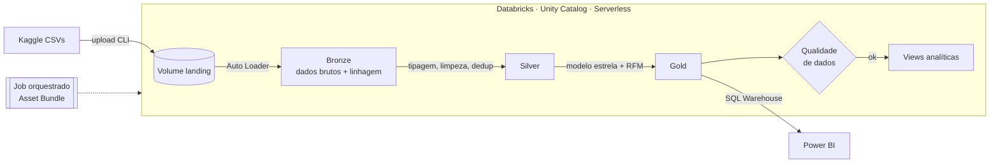
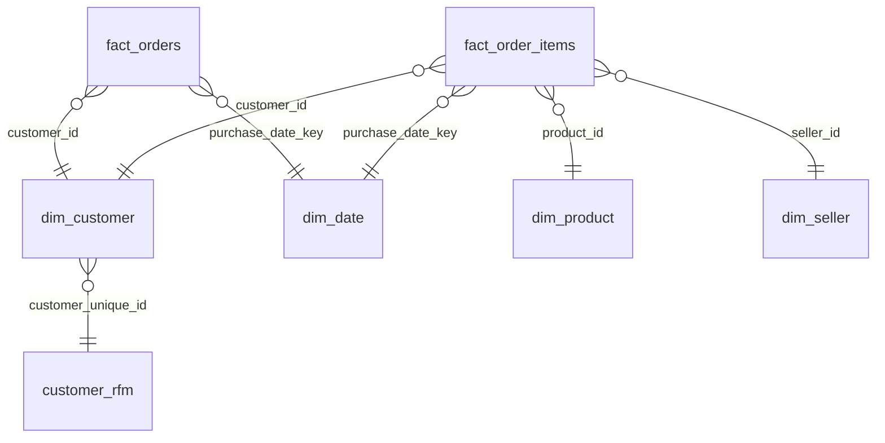

# 🛒 Olist Lakehouse: Databricks + Power BI

Pipeline de dados ponta a ponta sobre o **e-commerce brasileiro Olist** (~100 mil pedidos, 2016–2018):
ingestão incremental no Databricks com arquitetura medalhão, modelo estrela no Unity Catalog,
testes de qualidade automatizados e dashboard no Power BI.


<!-- substitua pela captura de tela do seu dashboard -->

## Arquitetura



| Camada | Notebook | O que faz |
|---|---|---|
| Setup | [`00_setup`](notebooks/00_setup.py) | Cria schemas e volumes e valida os arquivos de entrada |
| Bronze | [`01_bronze_ingestion`](notebooks/01_bronze_ingestion.py) | Auto Loader incremental (`availableNow`), schema como string, metadados `_source_file` / `_ingested_at` |
| Silver | [`02_silver_transform`](notebooks/02_silver_transform.py) | `try_cast` seguro, padronização de texto, deduplicação pela versão mais recente, geolocalização por CEP |
| Gold | [`03_gold_star_schema`](notebooks/03_gold_star_schema.py) | 2 fatos + 4 dimensões, calendário em PT-BR, segmentação RFM |
| Qualidade | [`04_data_quality`](notebooks/04_data_quality.py) | 20 verificações (PK, FK, regras de negócio, reconciliação), histórico em `dq_results`; falha bloqueia o job |
| Views | [`05_bi_views`](notebooks/05_bi_views.py) | KPIs mensais, atraso × avaliação, desempenho de vendedores |

## Modelo estrela (Gold)



## Perguntas de negócio

1. Como receita, pedidos e ticket médio evoluíram mês a mês?
2. Quais estados e regiões sofrem mais com atraso na entrega?
3. **Quanto o atraso derruba a nota da avaliação?** (`vw_atraso_vs_avaliacao`)
4. Quais categorias e vendedores concentram a receita, e qual é a satisfação deles?
5. Como se distribui a base de clientes nos segmentos RFM, e quanto ela é recorrente?

## Principais insights

<!-- Preencha com os números reais depois de rodar o pipeline. Recrutadores leem esta seção primeiro. -->
- 📦 …% dos pedidos entregues chegaram com atraso; a pior UF foi …
- ⭐ Pedidos atrasados têm nota média … contra … dos pedidos no prazo
- 🔁 Só …% dos clientes compraram mais de uma vez: retenção é a maior oportunidade
- 🏷️ As 5 maiores categorias concentram …% da receita

## Como reproduzir

**Pré-requisitos:** conta na [Databricks Free Edition](https://www.databricks.com/learn/free-edition), [Databricks CLI](https://docs.databricks.com/dev-tools/cli/install.html) e Power BI Desktop.

```powershell
# 1. Autenticar a CLI no seu workspace
databricks auth login --host https://<seu-workspace>.cloud.databricks.com

# 2. Deploy do job (notebooks + orquestração)
databricks bundle deploy

# 3. Rodar o setup uma vez para criar o volume (vai falhar avisando que faltam arquivos, é esperado)
databricks bundle run olist_pipeline

# 4. Baixar o dataset e enviar os CSVs
#    https://www.kaggle.com/datasets/olistbr/brazilian-ecommerce  -> extrair em .\data
.\scripts\upload_dados.ps1 -Pasta .\data

# 5. Rodar o pipeline completo
databricks bundle run olist_pipeline
```

Alternativa sem CLI: importe a pasta `notebooks/` no workspace, crie o volume pelo Catalog Explorer, faça o upload dos CSVs pela interface e rode os notebooks em ordem.

Depois, siga o guia [`powerbi/README.md`](powerbi/README.md) para conectar o Power BI.

## Decisões técnicas

- **Bronze toda em string.** A ingestão nunca falha por tipo inválido. A tipagem com `try_cast` na Silver transforma lixo em `NULL`, e os testes de qualidade apontam o problema.
- **Auto Loader com `availableNow`.** Processa só arquivos novos, com checkpoint, mas roda como batch: sem cluster ligado 24/7 e compatível com serverless.
- **Deduplicação por `_ingested_at`.** Reenviar um CSV corrigido atualiza o dado sem duplicar.
- **Duas tabelas fato.** `fact_orders` (grão pedido) responde logística e satisfação; `fact_order_items` (grão item) responde produto e vendedor. Juntar tudo num grão só distorceria somas de frete e pagamento.
- **Qualidade como gate.** Um erro de qualidade interrompe o job antes das views, então o BI nunca lê dados inconsistentes.
- **Infra como código.** Job versionado com Databricks Asset Bundles.

## Próximos passos

- Converter as camadas para **Lakeflow Declarative Pipelines (DLT)** com `expectations`
- Fazer Silver incremental com `MERGE` e Change Data Feed
- Declarar PK/FK informativas no Unity Catalog
- Publicar o relatório no Power BI Service com atualização agendada

## Stack

Databricks (Unity Catalog, Auto Loader, Delta Lake, Jobs, Asset Bundles, SQL Warehouse) · PySpark · Spark SQL · Power BI (DAX) · PowerShell

---
Dados: [Brazilian E-Commerce Public Dataset by Olist](https://www.kaggle.com/datasets/olistbr/brazilian-ecommerce) (CC BY-NC-SA 4.0).
